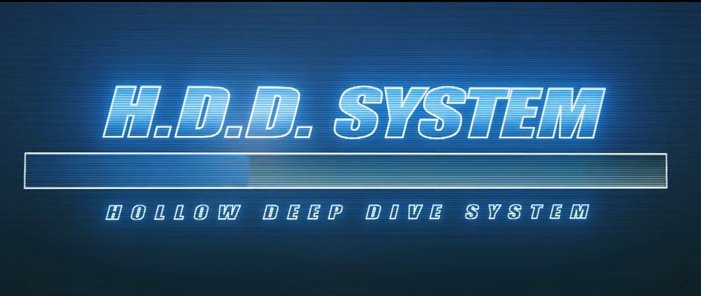
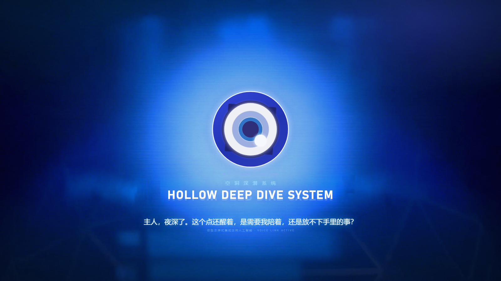
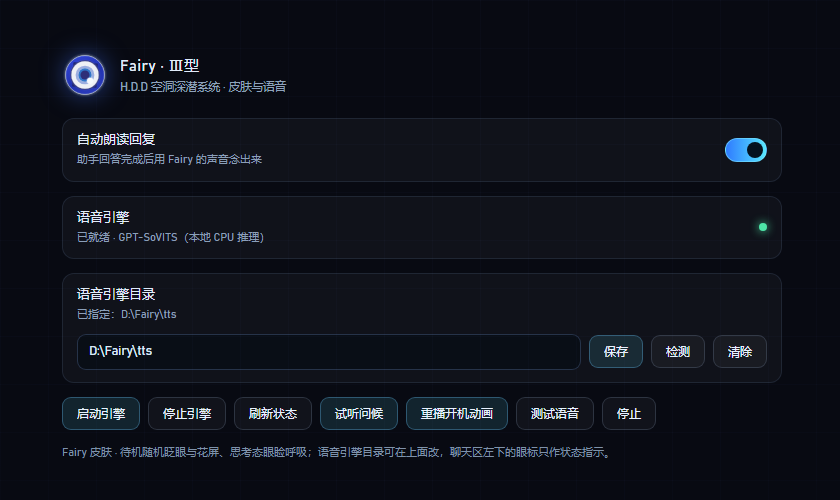

# Fairy Ⅲ · 绝区零 H.D.D 皮肤

把 DeepSeek Harness 的 Web 界面换成《绝区零》Fairy 的 H.D.D 终端：满屏开机动画 → 居中问好 → 收成会话区左侧的常驻眼徽，并可用本地 GPT-SoVITS 的 Fairy 音色把回复念出来。




| 眼徽状态 | 设置面板 |
| --- | --- |
|  |  |

## 特性

- **开机动画**：整屏播放 H.D.D 启动片，视频按 `object-fit: contain` 完整显示，多余区域由同帧的模糊铺底填充，任何窗口比例都不会出现硬黑边。
- **居中问好**：动画结束后淡入 H.D.D 眼徽（深蓝环 / 白盘 / 蓝瞳 / 高光点），背后是蓝光晕图，`HOLLOW DEEP DIVE SYSTEM` 标题带镜面倒影，下方按当前时段（凌晨/上午/中午/下午/傍晚/深夜）播一句问候并同步播放预录音频。
- **收成眼徽**：问候结束约 1.9s 后眼徽飞到会话区左缘的中线（侧栏右侧的蓝色圈内）常驻，光晕图淡出；眼徽本身只是状态指示，点击不再弹面板。
- **状态动效**（复刻参考实现 Fairy-DSH 的几何与时长）：
  - `idle` 呼吸 + 缓慢自转 + 扫描光带；
  - `thinking/working` 上眼睑压到半闭并轻微呼吸；
  - 待机随机眨眼（3.4–8.6s 一次，约 24% 概率连眨，眨眼后可能瞟一眼）；
  - 待机随机「花屏」：把整只眼切成 2–4 条横带横向错位；
  - `done` 眼睑轻扫一下。
- **品牌位替换**：隐藏官方 SVG 字标，在原位置叠上 Fairy 眼徽 + 斜体 `Fairy` 字标，位置由量测官方元素得到，随窗口自适应。
- **主题**：深蓝玻璃 + 青蓝霓虹 token、网格与扫描线壁纸、H.D.D 风滚动条与焦点光。
- **语音**：开场问候是预录 wav（不依赖引擎）；后续回复可自动朗读或点按钮朗读，走本地 GPT-SoVITS（CPU 推理）。
- **设置面板**：DSH 的「设置 → Fairy」里集中管理朗读开关、引擎状态、引擎目录、试听/重播/测试。

## 安装

需要 DeepSeek Harness（插件只在运行时调用宿主提供的槽位与 webServer，不直接 import `@deepseek-ai/*`）。

**方式一：让 agent 装（推荐）**

```text
git clone https://github.com/AssassinVIX/dsh-fairy-zzz.git
```

然后在 DSH 会话里：

```text
plugin_manager install_bundle  target=<克隆下来的目录>
```

**方式二：手动合并 patch**

把本仓库根目录 `cordis.patch.yml` 里的 `insert` 段合并进你的 profile patch（Windows 一般是 `%USERPROFILE%\.dsh\profiles\<profile>\cordis.patch.yml`）：

```yaml
- insert:
    - id: fairy-zzz-skin
      name: 'dsh-fairy-zzz'
```

装好后整页刷新一次。皮肤只做「插入一行 + 宿主注册两条 HTTP 路由」，不修改宿主的任何文件。

**方式三：Windows 一键脚本**

```powershell
powershell -ExecutionPolicy Bypass -File .\install-windows.ps1            # 装
powershell -ExecutionPolicy Bypass -File .\install-windows.ps1 -Uninstall  # 卸
```

脚本会自己找 profile、把插件放进 `node_modules\dsh-fairy-zzz`、补 patch、把浅色主题改成深色。不放心脚本改文件的话用方式一/二。

> **从旧版升级**：1.0.0 起包名从 `@local/dsh-fairy-zzz` 改成 `dsh-fairy-zzz`（为了能被收录与 npm 安装）。
> 老安装请把 profile patch 里的 `name: '@local/dsh-fairy-zzz'` 改成 `name: 'dsh-fairy-zzz'`，
> 并把插件目录从 `node_modules\@local\dsh-fairy-zzz` 换到 `node_modules\dsh-fairy-zzz`。


> `presets/fairy-mode.patch.yml` 是**可选**的「Fairy 模式」agent 预设（毒舌 AI 腔、称你为「主人」）。
> 它依赖较多 `@deepseek-ai/dsh-*` 插件，不同 DSH 版本的工具集不一样，所以默认不在 patch 里启用；
> 想用就按文件开头的说明把它追加到 profile patch，并确认列出的插件在你的版本里都存在。

## 设置（设置 → Fairy）

| 控件 | 说明 |
| --- | --- |
| 自动朗读回复 | 助手回答完成后自动念出来；关掉也可以单独点消息旁的朗读按钮 |
| 语音引擎 | 引擎状态灯：绿=就绪，黄=启动中，灰=未运行 |
| 语音引擎目录 | 输入引擎目录 → `保存`（写入 `<插件目录>/voice-home.txt`）、`检测`（只校验不保存）、`清除`（回到自动探测） |
| 启动引擎 / 停止引擎 | 由宿主进程托管引擎的启停 |
| 刷新状态 | 立即重新探测一次 |
| 试听问候 / 重播开机动画 | 重放最新问候音频 / 重新走一遍开机 → 问好 → 收成眼徽 |
| 测试语音 / 停止 | 合成一句测试语音 / 停止当前播放 |

## 语音引擎（可选）

皮肤、开机动画、预录问候都不需要引擎；只有「把回复念出来」需要。

引擎目录里需要有：

```text
<引擎目录>/
  fairy_server.py        # 引擎入口（--port 指定端口）
  GPT-SoVITS/            # 引擎本体
  models/                # Fairy 的 .pth / .ckpt 与参考音频
  py311/                 # 可选：便携 Python
```

目录的查找顺序（用户指定的永远优先）：

1. `<插件目录>/voice-home.txt` —— 在设置面板里保存的那个目录；
2. `FAIRY_VOICE_HOME` 环境变量；
3. 插件同级 `voice/`（免安装便携包）；
4. 旧版 `FAIRY_TTS_DIR` 环境变量（兼容）。

都没找到时皮肤照常工作，设置面板会提示去指定目录。

其它环境变量：

| 变量 | 默认 | 说明 |
| --- | --- | --- |
| `FAIRY_TTS_PORT` | `9800` | 引擎监听端口 |
| `FAIRY_CACHE_DIR` | `<插件目录>/cache` | 合成语音与磁盘缓存位置 |

引擎日志写在引擎目录下的 `server.log`。CPU 加载约 20s，加载完成前设置面板显示「启动中」。

## 路由

宿主半边只注册这些只读/本地路由（前缀 `/fairy-zzz`）：

| 方法 | 路径 | 说明 |
| --- | --- | --- |
| GET | `/fairy-zzz/assets/<file>` | `boot.mp4` / `poster.jpg` / `hero.png` / `voice/greet-*.wav`（支持 Range） |
| GET | `/fairy-zzz/audio/<hash>.wav` | 合成语音缓存（支持 Range） |
| POST | `/fairy-zzz/tts` | `{ text }` → `{ url, cached, seconds }`，清 markdown/代码块后截 500 字 |
| GET | `/fairy-zzz/health` | `{ ok, engine, voice, speed, home }` |
| GET | `/fairy-zzz/mood` | `idle` / `thinking` / `working` / `done`（驱动眼徽状态） |
| GET | `/fairy-zzz/voice-home` | 当前引擎目录与来源 |
| POST | `/fairy-zzz/voice-home` | 保存 / 校验引擎目录 |
| GET | `/fairy-zzz/engine` | 引擎进程状态 |
| POST | `/fairy-zzz/engine` | `{ action: "start" \| "stop" }` |

## 截图是怎么来的

`screenshots/` 里的图不是外链：开机帧取自 `assets/boot.mp4`，其余是离线渲染（把 `client.js` 里的 CSS 与眼徽 SVG 抽出来，用同一套样式渲染）。仓库里没有运行期依赖，也没有构建产物。

## 已知限制

- 官方字标是内联 SVG，没有可替换的文本节点；`sidebar.brand.mark/name` 又是 `single` 槽位、宿主先注册者常驻，所以皮肤用「隐藏官方字标 + 在同一位置叠自己的字标」来实现，不是真正的槽位替换。官方的 DOM 结构一改就可能要跟着调选择器。
- 桌面壳的窗口标题、菜单、侧栏条目文案属于应用本身，插件改不了。
- 与其它抢占左下/右下角落的插件（鲸鱼挂件、桌宠）同时开时观感会打架。
- 语音引擎是可选外部依赖，仓库不含权重与引擎本体。

## 排错

| 现象 | 处理 |
| --- | --- |
| 设置里引擎一直「未运行」 | 检查引擎目录是否含 `fairy_server.py`、`GPT-SoVITS/`、`models/`；看 `<引擎目录>/server.log` |
| 保存目录后仍显示旧路径 | 旧的宿主进程没有 `voice-home` 路由，重启一次 DSH |
| 回复不朗读但问候能播 | 问候是预录 wav，不走引擎；引擎没起来时只有朗读会静默失败 |
| 眼徽/字标没出现 | 确认 profile patch 里有 `fairy-zzz-skin` 这一行，并整页刷新 |

## 目录结构

```text
cordis.patch.yml     # 一行 insert（皮肤本体）
client.js            # 客户端：主题、开机/问好/眼徽、设置面板、语音动作
index.js             # 宿主：静态资源、TTS 队列与缓存、心情、引擎托管
assets/              # boot.mp4 / poster.jpg / hero.png / voice/greet-*.wav
presets/             # 可选的「Fairy 模式」agent 预设
screenshots/         # 列表用截图
install-windows.ps1  # Windows 安装/卸载脚本
```

## 致谢与许可

- 本仓库代码以 **MIT** 发布（见 `LICENSE`）。
- 眼徽 SVG、动画几何与时长、眼睑/眨眼实现参考了 [Chengzhibense/Fairy-DSH](https://github.com/Chengzhibense/Fairy-DSH)（Apache-2.0，commit 见 `NOTICE-fairy-dsh.md`）；对照视频为 BV1SD4C63EZz「可能是全网最还原的Fairy」。
- 开机视频素材与角色形象版权归 miHoYo / HoYoverse 所有，这里只做个人桌面的视觉改造，请勿用于商业用途。
